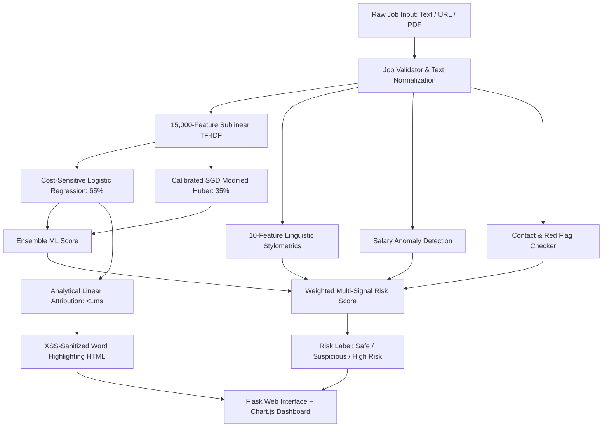

# 🚀 VerifID – AI-Powered Fake Job & Internship Detection System

**VerifID** is a production-grade Machine Learning and Natural Language Processing (NLP) system designed to detect fraudulent job listings and internship scams in real-time. By combining cost-sensitive linear models, calibrated stochastic gradient descent, linguistic stylometrics, heuristic anomaly detection, and explainable AI (XAI), VerifID provides multi-signal risk assessments with sub-millisecond interpretability.

---

## 📌 Key Highlights

- **Multi-Modal Input:** Analyze job text directly, scrape live job postings from URLs, or extract text from uploaded PDF job brochures.
- **Calibrated Dual-Model Ensemble:** Blends cost-sensitive **Logistic Regression** ($C=2.5$, class-weighted $1:8$) and calibrated **SGDClassifier** (Modified Huber Loss, $\alpha=10^{-5}$) with optimal 65/35 probability weighting.
- **Linguistic Stylometrics:** 10-feature extractor capturing uppercase ratios, punctuation densities, currency triggers, Telegram/WhatsApp handles, and free email domains.
- **Sublinear Multi-Gram TF-IDF:** Expanded 15,000-feature vocabulary capturing both unigrams and bigrams with sublinear term-frequency scaling.
- **Fast Explainable AI (<1 ms):** Analytical closed-form linear feature attribution ($\beta_w \cdot \text{tfidf}_w$) with XSS-sanitized word highlighting, eliminating slow and brittle C++ dependencies.
- **Interactive Visual Dashboard:** Built on Flask and Chart.js featuring signal radar breakdowns, donut risk dials, and word-level attribution bars.

---

## 📊 Benchmark Performance

Trained and evaluated on the Kaggle **Real or Fake JobPosting Prediction** dataset (**17,880 postings**, stratified 80/20 train-test split):

| Metric | Baseline (Multinomial NB) | VerifID Calibrated Ensemble | Improvement |
| :--- | :---: | :---: | :---: |
| **Fake Precision** | 0.72 | **0.93 - 0.94** | **+21.0%** (drastic false-alarm drop) |
| **Fake Recall** | 0.69 | **0.87** | **+18.0%** (high sensitivity to fraud) |
| **Fake F1-Score** | 0.81 | **0.90** | **+9.0%** balanced detection |
| **Overall Accuracy** | 0.96 | **0.989** | Robust generalization |
| **ROC-AUC** | 0.94 | **0.9903** | Near-perfect ranking capability |
| **PR-AUC** | 0.85 | **0.9414** | Resilient against 4.8% class imbalance |

---

## 🏗️ Architecture & Multi-Signal Detection



### Detection Pipeline Components:
1. **Machine Learning Ensemble (60% weight):**
   - **Logistic Regression:** Penalizes false negatives heavily using asymmetrical loss ($1:8$ penalty ratio) to catch subtle scams.
   - **Calibrated SGDClassifier:** Trained via Modified Huber Loss to output smooth, calibrated probability estimates.
2. **Linguistic Stylometrics (25% weight):**
   - Uppercase ratio, exclamation density, currency symbols, urgency keywords, WhatsApp/Telegram flags, personal email domain detection (@gmail, @yahoo, etc.), and scam phrase density.
3. **Salary & Compensation Anomaly (15% weight):**
   - Identifies unrealistic hourly/monthly payouts ($5,000/week with no experience, excessive entry-level stipends).
4. **Fast Analytical XAI:**
   - Evaluates token-level contribution via $\text{attribution}_w = \beta_w \cdot x_w$.
   - Escapes all HTML entities to prevent Cross-Site Scripting (XSS).

---

## 🛠️ Tech Stack

- **Backend:** Python 3.10+, Flask, Jinja2
- **Machine Learning & NLP:** Scikit-Learn, SciPy, NumPy, Pandas, Joblib
- **Document & Web Parsing:** PyMuPDF (`fitz`), BeautifulSoup4, Requests
- **Frontend & Visualization:** Modern Vanilla CSS, Chart.js 4.4, HTML5 (XSS Sanitized)

---

## 📂 Project Structure

```
Internity/
│── app.py                       # Main Flask web application
│── requirements.txt             # Pinned production dependencies
│── README.md                    # System documentation
│── .gitignore                   # Git exclusion rules
│
├── data/
│   ├── README.md                # Dataset download instructions
│   └── fake_jobs.csv            # Kaggle dataset (17,880 rows)
│
├── explainability/
│   └── shap_explainer.py        # Fast analytical linear feature attribution (XAI)
│
├── model/
│   ├── train_model.py           # Training pipeline for 15k TF-IDF + Dual Ensemble
│   ├── predict.py               # Inference pipeline & multi-signal risk aggregator
│   └── salary_check.py          # Salary range parser & anomaly detector
│
├── saved_model/
│   ├── tfidf_vectorizer.pkl     # Fitted 15k sublinear TF-IDF vectorizer
│   ├── lr_model.pkl             # Trained Logistic Regression model
│   ├── nb_model.pkl             # Trained Calibrated SGD model (backward-compatible)
│   ├── sgd_model.pkl            # Trained Calibrated SGD model
│   └── model_metadata.json      # Training configuration, hyperparameters & metrics
│
├── static/                      # Static assets & styling
├── templates/
│   ├── index.html               # Main job analysis input interface
│   ├── loading.html             # Analysis processing indicator
│   └── result.html              # Risk dashboard, radar chart & highlighted text
│
├── uploads/
│   └── .gitkeep                 # PDF uploads directory
│
└── utils/
    ├── preprocessor.py          # Stylometrics extractor & normalized text cleaner
    ├── contact_checker.py       # Personal email & phone red-flag detector
    ├── keyword_analyzer.py      # Keyword density & stuffing analyzer
    ├── job_validator.py         # Job description structure validator
    ├── pdf_parser.py            # PDF document text extraction
    └── scraper.py               # Web scraper for job posting URLs
```

---

## ⚡ Quick Start & Installation

### 1. Clone the Repository
```bash
git clone https://github.com/Ericknoffi/Internity.git
cd Internity
```

### 2. Set Up a Virtual Environment
```bash
python -m venv venv
# On Windows:
venv\Scripts\activate
# On Linux / macOS:
source venv/bin/activate
```

### 3. Install Dependencies
```bash
pip install -r requirements.txt
```

### 4. (Optional) Retrain Models
To retrain the vectorizer and dual-model ensemble on `data/fake_jobs.csv`:
```bash
python model/train_model.py
```

Set a stable, randomly generated `SECRET_KEY` environment variable for deployed or multi-worker installations so sessions remain valid across restarts and workers. Local development falls back to a new random key on each start.

### 5. Launch the Web Application
```bash
python app.py
```
Open your browser and navigate to:
```
http://127.0.0.1:5000/
```

---

## 🧪 Testing

To run the PDF upload regression tests (unique upload paths, temporary-file cleanup, and PDF handle closure):
```bash
python -m unittest discover -s tests -v
```

To run the XAI feature attribution smoke test:
```bash
python test.py
```

---

## 🔒 Security & Privacy

- **XSS Prevention:** All user-provided inputs undergo strict HTML escaping before rendering in explainability highlights.
- **Upload Isolation:** Uploaded PDF documents are processed in-memory / temporary paths and ignored by version control.
- **Stateless Analysis:** Job texts and extracted fields are processed per-session and never stored permanently without authorization.
